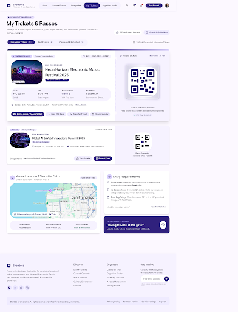

# Eventora

Eventora is a full-stack event discovery and ticketing platform for attendees and organizers. It combines a React/Vite experience with a Django REST API for authentication, event management, bookings, favorites, digital tickets, QR check-in, payments, and organizer analytics.

## Features

- Discover featured, upcoming, and category-based events
- Search and filter events by category, venue, date, format, and price
- Create and manage organizer accounts
- Publish events with ticket tiers and venue details
- Add events to a personal favorites list
- Complete mock event bookings and payment flows
- Download tickets as PDF files with QR codes
- Verify tickets and record gate check-ins with a QR scanner
- View organizer revenue, ticket sales, capacity, and order analytics
- Manage attendee, organizer, and administrator roles

## Tech Stack

### Frontend

- React 19
- Vite
- React Router
- Axios
- Tailwind CSS
- Recharts
- HTML5 QR Code
- jsPDF
- QRCode React
- Lucide React

### Backend

- Python
- Django 5
- Django REST Framework
- Simple JWT
- Django CORS Headers
- SQLite or MySQL
- Pillow and QR code generation

## Project Structure

```text
DjangoCa1/
├── backend/
│   ├── accounts/       # Registration, login, JWT, and user profiles
│   ├── analytics/      # Organizer dashboard statistics
│   ├── bookings/       # Booking creation and order management
│   ├── events/         # Events, categories, venues, and reviews
│   ├── favorites/      # Saved event management
│   ├── payments/       # Mock payment processing
│   ├── tickets/        # Ticket issuance, PDF, cancellation, and QR verification
│   ├── config/         # Django project settings and URLs
│   └── manage.py
└── frontend/
    ├── src/
    │   ├── components/ # Shared UI components and modals
    │   ├── context/    # Authentication and favorites state
    │   ├── pages/      # Route-level application screens
    │   └── services/   # Axios API client
    └── package.json
```

## Screenshots

| Home | Explore |
|---|---|
|  |  |

| Event Details | My Tickets |
|---|---|
|  |  |

| Organizer Dashboard |
|---|
|  |

## Getting Started

### Prerequisites

- Python 3.10 or newer
- Node.js 20.19 or newer
- npm
- Git

### 1. Clone the repository

```bash
git clone https://github.com/aamirgada/EventOra.git
cd EventOra
```

### 2. Configure the backend

```bash
cd backend
python -m venv .venv
```

Activate the virtual environment on Windows:

```powershell
.venv\Scripts\Activate.ps1
```

Activate it on macOS or Linux:

```bash
source .venv/bin/activate
```

Install dependencies:

```bash
python -m pip install --upgrade pip
pip install -r requirements.txt
```

Copy the environment example:

```bash
copy .env.example .env
```

SQLite is the default database and requires no additional database setup.

To use MySQL, set the database fields in `backend/.env` and add:

```dotenv
DB_ENGINE=django.db.backends.mysql
```

Apply migrations and seed demo data:

```bash
python manage.py migrate
python manage.py seed_data
```

Start the backend:

```bash
python manage.py runserver
```

The API is available at `http://localhost:8000`, and the Django admin is available at `http://localhost:8000/admin/`.

### 3. Configure and start the frontend

Open a second terminal:

```bash
cd frontend
npm install
npm run dev
```

The frontend runs at `http://localhost:5173` by default.

To use a different API URL, create `frontend/.env.local`:

```dotenv
VITE_API_URL=http://localhost:8000/api
```

## Demo Accounts

The seed command creates the following accounts:

| Role | Email | Password |
|---|---|---|
| Administrator | `admin@eventora.com` | `Admin@123` |
| Organizer | `organizer@eventora.com` | `Organizer@123` |
| Attendee | `attendee@eventora.com` | `Attendee@123` |

Change or remove seed credentials before deploying the application.

## API Overview

| Area | Base path | Purpose |
|---|---|---|
| Authentication | `/api/auth/` | Registration, login, token refresh, and profile |
| Events | `/api/events/` | Event discovery, details, categories, venues, creation, and reviews |
| Bookings | `/api/bookings/` | Booking creation and order access |
| Tickets | `/api/tickets/` | My tickets, ticket details, PDF downloads, cancellation, and QR verification |
| Payments | `/api/payments/` | Mock payment processing and payment details |
| Favorites | `/api/favorites/` | Add, remove, and list favorite events |
| Analytics | `/api/analytics/` | Organizer dashboard metrics |

The backend root, `http://localhost:8000/`, also exposes a JSON service status and endpoint summary.

## Available Scripts

### Backend

```bash
python manage.py migrate
python manage.py seed_data
python manage.py runserver
python manage.py test
```

### Frontend

```bash
npm run dev
npm run build
npm run lint
npm run preview
```

## Environment Variables

### Backend

| Variable | Description | Default |
|---|---|---|
| `DJANGO_SECRET_KEY` | Django signing secret | Development fallback |
| `DJANGO_DEBUG` | Enable Django debug mode | `True` |
| `DJANGO_ALLOWED_HOSTS` | Comma-separated allowed hosts | `localhost,127.0.0.1` |
| `DB_ENGINE` | Django database backend | SQLite |
| `DB_NAME` | Database name for MySQL | `eventora_db` |
| `DB_USER` | Database username | `root` |
| `DB_PASSWORD` | Database password | `root` |
| `DB_HOST` | Database host | `127.0.0.1` |
| `DB_PORT` | Database port | `3306` |
| `PAYMENT_PROVIDER` | Payment provider mode | `mock` |
| `RAZORPAY_KEY_ID` | Optional Razorpay key ID | Empty |
| `RAZORPAY_KEY_SECRET` | Optional Razorpay key secret | Empty |

### Frontend

| Variable | Description | Default |
|---|---|---|
| `VITE_API_URL` | Backend API base URL | `http://localhost:8000/api` |

## Security Notes

- Replace the development Django secret key before deployment.
- Set `DJANGO_DEBUG=False` and configure `DJANGO_ALLOWED_HOSTS` for production.
- Use strong database and administrator credentials.
- Store real payment credentials only in server-side environment variables.
- Configure a production CORS origin explicitly.

## License

No license has been added to this repository yet. Add an appropriate `LICENSE` file before reusing or distributing the project.
